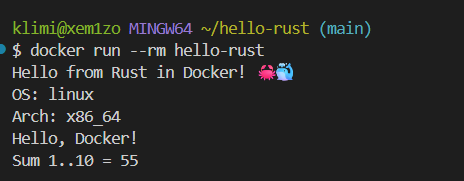

# hello-rust

Учебный проект с CI/CD на GitHub Actions для Rust-приложения с публикацией в GHCR.

## 📌 Цель работы

Научиться публиковать Docker-образ в **GHCR (GitHub Container Registry)** автоматически при push в `main`. Это превращает CI в **CI/CD** — код не только проверяется, но и превращается в готовый к развёртыванию артефакт.

## 🎯 Что делает CI/CD

При каждом push в `main`:

- **Format check** — `cargo fmt --check`
- **Lint** — `cargo clippy --all-targets -- -D warnings`
- **Tests** — `cargo test`
- **Build** — `cargo build --release`
- **Publish** — `docker build` + `docker push` в **GHCR**: `ghcr.io/xem1zo/hello-rust:latest`

## 📂 Структура проекта

```
hello-rust/
├── .github/workflows/ci.yml
├── src/
│   ├── main.rs
│   └── lib.rs
├── tests/
│   └── integration.rs
├── .gitignore
├── .dockerignore
├── Dockerfile
├── Cargo.toml
└── README.md
```

## 🦀 Основной код

**`src/lib.rs`:**
```rust
pub fn greet(name: &str) -> String {
    format!("Hello, {}!", name)
}

pub fn sum_range(from: i64, to: i64) -> i64 {
    (from..=to).sum()
}
```

**`src/main.rs`:**
```rust
use hello_rust::{greet, sum_range};

fn main() {
    println!("Hello from Rust in Docker! 🦀🐳");
    println!("OS: {}", std::env::consts::OS);
    println!("Arch: {}", std::env::consts::ARCH);
    println!("{}", greet("Docker"));
    println!("Sum 1..10 = {}", sum_range(1, 10));
}
```

## 🚀 Запуск локально

### Сборка и запуск Docker-образа

```bash
docker build -t hello-rust .
docker run --rm hello-rust
```

Ожидаемый вывод:
```
Hello from Rust in Docker! 🦀🐳
OS: linux
Arch: x86_64
Hello, Docker!
Sum 1..10 = 55
```

### Скачать образ из GHCR

```bash
docker pull ghcr.io/xem1zo/hello-rust:latest
docker run --rm ghcr.io/xem1zo/hello-rust
```

## 📸 Результат запуска



## ✅ Результат

При push в ветку `main`:
- Все проверки проходят ✅
- Docker-образ автоматически публикуется в **GHCR**
- Образ доступен по адресу: `ghcr.io/xem1zo/hello-rust:latest`

**Ссылка на Actions:**  
https://github.com/xem1zo/hello-rust/actions

**Пакет в GHCR:**  
https://github.com/xem1zo?tab=packages

## 📝 Вывод

В ходе работы я освоил:

- Настройку CI/CD в GitHub Actions
- Публикацию Docker-образа в GHCR через `GITHUB_TOKEN`
- `docker/metadata-action` для автоматических тегов (SHA + latest)
- `docker/build-push-action` с кэшированием через `type=gha`
- Разницу между CI (проверка кода) и CI/CD (публикация артефакта)
- Работу с правами `permissions: packages: write` для публикации