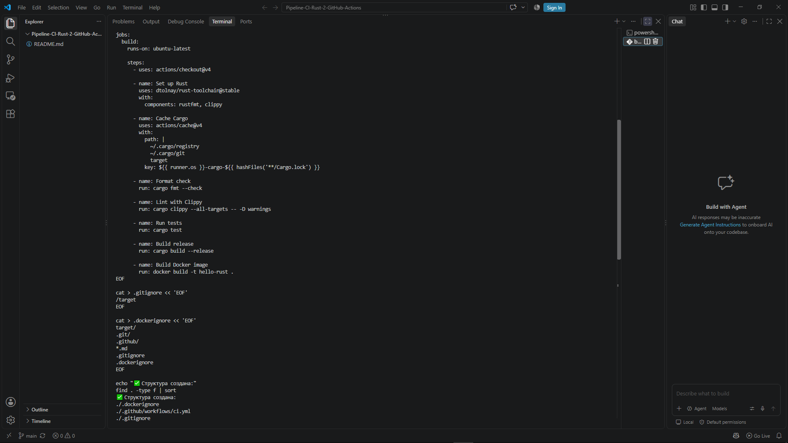
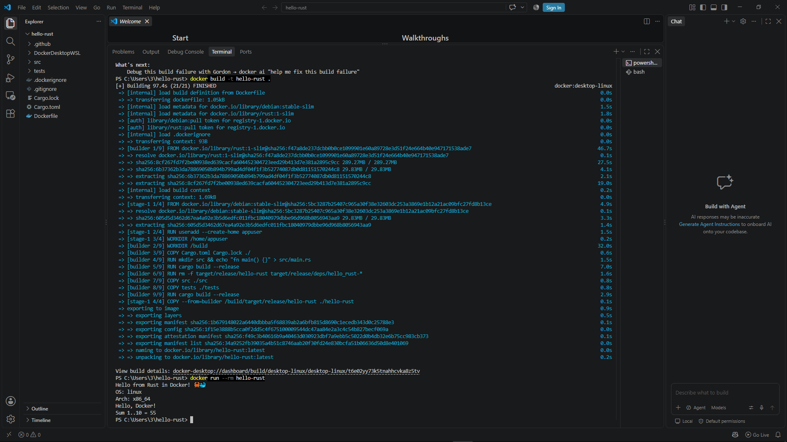
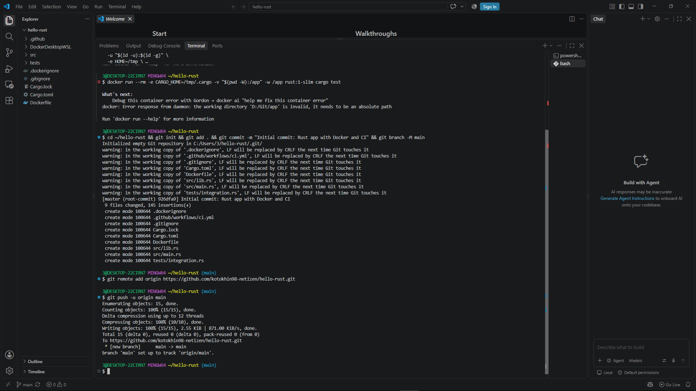
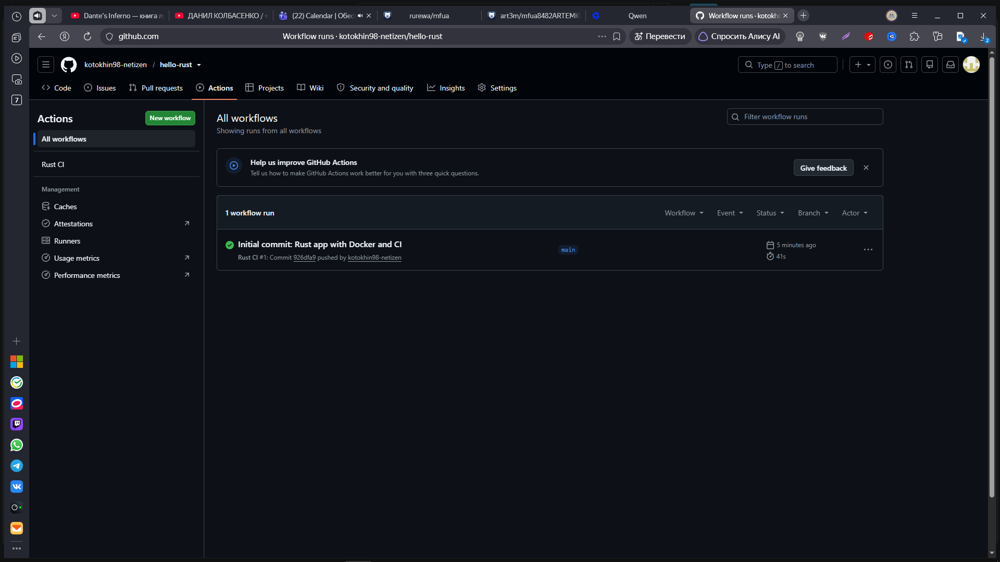

Отлично! Раз вы уже нашли свой логин (`kotokhin98-netizen`) и, надеюсь, успешно запушили код (или готовы это сделать), давайте сделаем ваш проект красивым.

Хороший `README.md` — это лицо проекта. Для учебного проекта по Rust и Docker важно показать, что вы понимаете, **зачем** используете эти технологии (например, маленький размер образа).

Вот готовый текст для вашего файла.

### Инструкция:
1. Создайте в папке `hello-rust` файл с именем `README.md`.
2. Скопируйте код ниже и вставьте его в этот файл.
3. Сохраните, добавьте в git и отправьте на GitHub.

```markdown
#  Hello Rust CI/CD Pipeline

Пример минималистичного приложения на **Rust**, демонстрирующий настройку **CI/CD пайплайна** через GitHub Actions и создание оптимизированного **Docker-образа**.

## 🚀 О проекте

Этот проект показывает преимущества использования Rust в контейнерах:
- **Многоступенчатая сборка (Multi-stage build):** Компиляция в тяжелом образе `rust:slim`, запуск в легком `debian:stable-slim`.
- **Оптимизация:** Бинарник сжат (`opt-level = "z"`, `LTO`, `strip`), что делает финальный образ extremely small (~15-20 МБ) по сравнению с аналогами на Java или Python.
- **Автоматизация:** При каждом push запускаются тесты, линтеры (Clippy) и проверка форматирования.

## 📂 Структура проекта

```text
.
├── .github/workflows/ci.yml   # Конфигурация CI (GitHub Actions)
├── src/
│   ├── main.rs                # Точка входа (CLI приложение)
│   └── lib.rs                 # Библиотечная логика + Unit-тесты
├── tests/
│   └── integration.rs         # Интеграционные тесты
├── Cargo.toml                 # Манифест проекта и настройки релиза
├── Dockerfile                 # Инструкция для сборки Docker образа
└── README.md
```


## 🛠 Локальный запуск

### Вариант 1: Через Docker (Рекомендуется)
Не требует установки Rust на компьютер.

```bash
# 1. Сборка образа
docker build -t hello-rust .


# 2. Запуск контейнера
docker run --rm hello-rust
```

**Ожидаемый вывод:**
```text
Hello from Rust in Docker! 🦀🐳
OS: linux
Arch: x86_64
Hello, Docker!
Sum 1..10 = 55
```




### Вариант 2: Локально (через Cargo)
Если у вас установлен Rust toolchain:

```bash
cargo run
# Или запуск тестов:
cargo test
```
 Создание пустого репозитория на GitHub
Создайте пустой репозиторий hello-rust на GitHub.

⚠️ Не добавляйте README, .gitignore и лицензию — иначе push будет отклонён.

6. Запушить проект
Находясь в каталоге проекта, выполнить последовательно:

cd ~/hello-rust && git init && git add . && git commit -m "Initial commit: Rust app with Docker and CI" && git branch -M main

git remote add origin https://github.com/<ВАШ-USERNAME>/hello-rust.git

где ВАШ-USERNAME — ваш логин на GitHub

git push -u origin main

После push откройте вкладку Actions в GitHub — workflow «Rust CI» запустится автоматически.



## ⚙️ CI Pipeline (GitHub Actions)




---

*Created by [kotokhin98-netizen](https://github.com/kotokhin98-netizen)*
